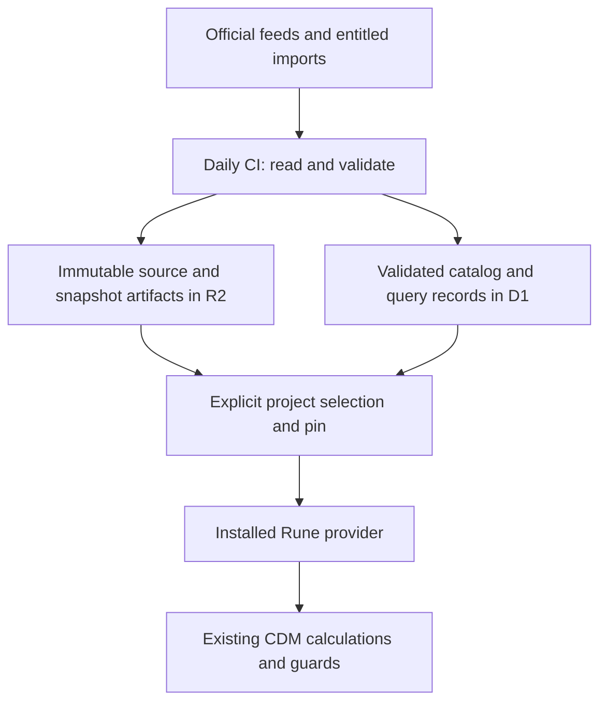

# Shared market-data catalog

Status: **first milestone implemented for local review**, 2026-11-13. Tracks the provider follow-up in
[#646](https://github.com/daikonic-org/rune-langium/issues/646).
[#707](https://github.com/daikonic-org/rune-langium/pull/707) includes the six-series
catalog, read API, portable imports and a gated daily CI publisher. Public read-service deployment and scheduled
activation have not been performed. A private SONIA OIS fitted-curve adapter now covers the BoE monthly/archive XLSX
grids. Other curve adapters, entitled term feeds and calendar-aware freshness
alerts remain subsequent work. The example D1/R2 store is provisioned; public
service deployment and scheduled activation remain separate.

## Deployment scope

The D1/R2 service is the **CDM example's reference-data provider**, implemented in
[`apps/cdm-example-data-worker`](../../../apps/cdm-example-data-worker/README.md).
It is not a Studio database or a required service for real projects. Production
projects supply their own providers and data sources. CI remains in the main
rune-langium repository and targets the example's separately configured resources.
Drizzle owns the example service's typed SQLite schema and routine queries;
Wrangler applies its generated migrations. No database/ORM dependency enters the
portable project-runtime layer.

## Purpose

Acquire public benchmark fixings, compounded indices and selected yield curves
once, retain their history and provenance, and let projects select reproducible
snapshots. Refresh the shared catalog daily through GitHub Actions. Projects
continue to calculate from explicitly installed data with no network dependency
during Build, code generation or Execute.

Use **Cloudflare D1 (managed SQLite)** for the example's queryable catalog and derived
records, and **R2** for immutable source responses and portable snapshot artifacts.
Use the same catalog for the six benchmark series already downloaded and for
future curve datasets. A local SQLite export supports inspection and offline
queries through the same data contracts.

## Fit with CDM providers

Storage and acquisition sit behind the existing provider boundary. They do not
change CDM function signatures or make a database the calculation engine.

| Layer | Responsibility |
| --- | --- |
| CDM functions | Request observations or quotes using their existing contracts; retain calculation and missing/ambiguous-data checks. |
| Installed project provider | Supply one explicitly selected, pinned dataset through the project's ordinary implementation mechanism. |
| Shared catalog | Discover datasets, query history, track revisions and prepare portable selections. |
| Ingestion | Read official feeds or entitled imports, validate their meaning and publish complete snapshots. |

`impl.cdm.market.ReadMarketObservations` and `ReadForwardRateSnapshot` are our
curated adapter contracts, not new upstream CDM APIs. The current overrides of
`IndexValueObservation` and `GetMarketRates` use the observation adapter. The
forward-rate integration remains a separate contract with a payout-specific
maturity and quote convention.

Keep one active implementation of each provider in a project. Catalog selection
materializes ordinary Rune source through the existing provider renderer and
implementation installation path. Explicit authored Rune bodies and declared
provider bindings keep their existing precedence; a refresh must never silently
replace them or create a competing override. Other provider implementations can
continue to supply the same contracts without using this catalog.

## Dataset scope

The first catalog release imports and refreshes all six existing series:

| Dataset | Provider series | Meaning |
| --- | --- | --- |
| `sofr` | New York Fed `SOFR` | Overnight fixing, percent converted to decimal rate |
| `sonia` | Bank of England `IUDSOIA` | Overnight fixing, percent converted to decimal rate |
| `estr` | ECB `EST.B.EU000A2X2A25.WT` | Overnight fixing, percent converted to decimal rate |
| `sofr-index` | New York Fed `SOFRAI.index` | Published compounded index level, unscaled |
| `sonia-index` | Bank of England `IUDZOS2` | Published compounded index level, unscaled |
| `estr-index` | ECB `EST.B.EU000A2QQF08.CI` | Published compounded index level, unscaled |

Import existing version-1 JSON snapshots without fetching again or changing
their source URL, retrieval timestamp, raw response or checksum. Record catalog
ingestion time separately. Exact observation dates, units and CDM identities
remain governed by `@rune-langium/project-runtime/market-data`.

The SONIA OIS adapter stores private fitted spot/instantaneous-forward grids with
continuous compounding and ACT/365 conventions; it does not label fitted points
as par instrument quotes. Other curve adapters use the same artifact/catalog model, with separate
profiles for each source's quote conventions and availability:

| Candidate source | Available material | Admission requirement |
| --- | --- | --- |
| [US Treasury](https://home.treasury.gov/interest-rates-data-csv-archive/) | Nominal and real par yield histories | Preserve par-quote identity; discount factors require an explicit bootstrap. |
| Federal Reserve [nominal](https://www.federalreserve.gov/data/nominal-yield-curve.htm) and [TIPS](https://www.federalreserve.gov/data/tips-yield-curve-and-inflation-compensation.htm) research curves | Estimated daily yields and model parameters | Preserve model/vintage identity and weekly release cadence; current history can contain revisions. |
| [ECB euro-area yield curves](https://www.ecb.europa.eu/stats/financial_markets_and_interest_rates/euro_area_yield_curves/html/index.en.html) | Government spot, forward and par curves | Distinguish AAA/all-government samples, quote kinds and the source's stated use restrictions. |
| [BoE yield curves](https://www.bankofengland.co.uk/statistics/yield-curves) | Gilt nominal/real/inflation curves and SONIA OIS archives | Preserve continuously compounded quote conventions, historical day-count changes, maturity coverage and dataset-specific reuse rights. |

A government yield curve, an OIS curve, a forward quote and a published term
benchmark are distinct datasets. The catalog must not silently substitute one for
another. Published term SOFR/SONIA/€STR and vendor feeds remain separate adapters
requiring an entitled import or API. Historical overnight data alone cannot
reconstruct a published forward-looking term benchmark.

## Reuse existing readers and import services

Do not implement CSV quoting, spreadsheet decoding, ZIP extraction or database
bulk-loading protocols when a suitable maintained implementation exists. Keep
custom code limited to source identity, column mapping, dates, units, validation
and provider materialization.

| Work | Preferred approach |
| --- | --- |
| Existing bounded CSV snapshot replay | Maintained `csv-parse` reader with its browser ESM entry; retain the shared strict feed validation. |
| Larger acquisition or conversion in CI | Evaluate native/standard tools first, such as Python's `csv` reader, SQLite's CSV import or DuckDB readers; pin the selected tool and record its version. |
| Spreadsheet/archive feeds | Prefer the source's supported CSV/JSON/SDMX export; otherwise select a maintained reader for the actual format and runtime. |
| D1 incremental writes | Existing binding/REST interfaces with bound values and bounded batches. |
| Initial D1 load or bounded backfill | Evaluate Wrangler SQL import and the D1 bulk-import REST API before building upload or polling infrastructure. |
| R2 transfer | Existing R2 binding, Wrangler or supported object-storage client. |

Selection is based on format fidelity, strict-error behavior, memory limits,
license and deployment compatibility, rather than requiring TypeScript for CI
acquisition. Native CI dependencies need not ship to the browser or Worker.
Conversely, a Node-only reader must not leak into the host-neutral runtime.

For each admitted format, choose one authoritative format-decoding path; do not
maintain a TypeScript parser and a second native parser with subtly different
rules. If CI uses a native reader, publish a versioned, validated intermediate
record artifact for consumers rather than asking every host to reinterpret that
format. Preserve the raw source artifact alongside it. Existing CSV snapshots
continue through their shared decoder. Cross-format intermediates must pass the
same identity/date/unit rules; no second percentage-conversion or pricing logic.

D1's import service consumes SQL; it is a storage-loading interface, not an
upstream market-feed decoder or validator. Imports must target staging/catalog
records and obey the same publication gate as incremental writes. Do not treat
SQLite CLI dot-commands as SQL accepted by D1, or pass upstream text as SQL.

Reader/API references: [CSV Parse browser ESM](https://csv.js.org/parse/distributions/browser_esm/),
[Python CSV](https://docs.python.org/3/library/csv.html),
[SQLite CSV import](https://sqlite.org/cli.html#importing_files_as_csv_or_other_formats),
[D1 import/export](https://developers.cloudflare.com/d1/best-practices/import-export-data/)
and [bulk-import API](https://developers.cloudflare.com/d1/tutorials/import-to-d1-with-rest-api/).

## Data and reproducibility contracts

Keep these logical records versioned; exact table/API names belong to the
implementation plan:

- **Dataset**: provider and administrator, benchmark/curve identity, currency,
  tenor where applicable, source series, quote kind, units, calendar/timezone,
  publication cadence, attribution, rights and access scope.
- **Raw artifact**: immutable original response bytes, content hash, canonical
  source URL, retrieval time, supplied transport headers and media type.
- **Snapshot**: dataset identity, source-artifact membership, observation/as-of
  coverage, decoding/convention versions and immutable snapshot identity.
- **Observation or curve point**: source date/value text, normalized value,
  source status/revision when present, and owning snapshot. Curves also identify
  maturity/tenor, quote convention, compounding, day count and model parameters
  when supplied.
- **Ingestion run**: source, run/attempt identity, acquisition time, pinned tool
  versions, outcome, reason and links to validated artifacts.
- **Publication/selection**: accepted snapshot generations and project pins.
  A multi-series selection records every constituent snapshot, not just “latest”.

Raw artifacts are authoritative for supplied values; query tables and normalized
artifacts are reproducible derivatives. Preserve decimal text through ingestion,
using the current decoder's numeric profile at execution boundaries. SQL floating
point storage must not become a second source of numeric truth.

Retain successive revisions as new snapshots. Deduplicate content-addressed raw
artifacts and idempotent publication retries. An unchanged acquisition reuses the
latest overlapping accepted capture and records its confirmation time separately
from immutable provenance. A response returning to A after an intervening B is
a new capture and generation; finding historical A bytes is not sufficient to
deduplicate it. Confirmation times cannot decrease, let late backfills displace
freshly confirmed observations, or alter existing generation pins. A decoder or
convention change produces a distinguishable derivation even for identical raw
data. Snapshot IDs must bind the complete manifest, including the first capture's
provenance, rather than only its observation values.

Distinguish observation/effective date, curve as-of date, source publication time
when actually supplied, first acquisition time and catalog ingestion time.
Downloading historical data today does not establish what was known on its
historical observation date. Expose vintage queries only to the extent supported
by retained captures or a source's real vintage service.

Selection queries use exact dataset identity, date range and explicit snapshot
or revision policy. Paginate and bound rows, response bytes and execution time.
Report missing dates and mismatched curve conventions rather than filling,
interpolating, extrapolating or switching sources implicitly. Cross-series
calculations pin each snapshot and check the caller's requested date coverage.

## Storage and publication

D1 holds dataset metadata, snapshot membership, observations, curve points,
ingestion outcomes and accepted generations. R2 retains immutable response,
normalized and portable export artifacts under a market-data namespace distinct
from curated model releases. Keep entitlement-scoped artifacts separate from
public delivery; record and enforce attribution/reuse conditions on exports.

Publish a dataset generation in this order:

1. Acquire and validate all of its required files and records in staging.
2. Upload immutable R2 artifacts and manifest; verify hashes/readback.
3. Load complete D1 staging rows in bounded batches. Readers cannot select them.
4. Atomically mark the complete snapshot accepted and advance the dataset's
   catalog generation, conditioned on the expected previous generation.
5. Read back the accepted manifest and a bounded query, then record success.

There is no transaction spanning R2 and D1. A crash before acceptance can leave
unreferenced artifacts or staging rows; retries reconcile them by identity.
Readers must never see a partially loaded snapshot. Older concurrent/backfill
runs cannot roll back the accepted default; an intentional historical correction
is a new accepted generation, with its previous generation retained.

Use D1 transactions/batches for the final visibility change, and supported import
facilities for large staging loads. Raw data permits rebuilding derived records;
recovering acceptance decisions, access policy and catalog state also requires
catalog checkpoints/backups. Recovery must not publish abandoned staging or
restricted artifacts automatically. No automatic deletion of pinned history.

Durable Objects are optional future per-feed coordination, not the initial data
store or scheduler. The repository's existing per-workspace LSP Durable Objects
remain independent. See Cloudflare's [storage guidance](https://developers.cloudflare.com/workers/platform/storage-options/)
and [D1 documentation](https://developers.cloudflare.com/d1/).

## Daily CI refresh

Use a dedicated GitHub Actions workflow on the default branch as the single
scheduler, following the curated publisher's existing CI ownership pattern.
Proposed schedule: **`17 20 * * *` (20:17 UTC daily)**. This is a polling time,
not a guarantee that each dataset publishes a new observation that day.

- Start with all six fixing/index datasets. Check curve datasets on the same
  daily run once their adapters and rights profiles are admitted; respect each
  source's actual daily, weekly or archive-update cadence.
- Re-read the latest seven calendar days for benchmark feeds to catch recent
  corrections. Use manual or source-specific periodic reconciliation for older
  revisions; a seven-day lookback is not a complete revision guarantee.
- Provide `workflow_dispatch` with validated dataset selection, bounded start/end
  dates and dry-run/publication mode for backfills and retries. Partition larger
  windows within the existing 366-date/2 MiB benchmark acquisition bounds.
- Isolate datasets/provider failures (`fail-fast: false` or equivalent). Publish
  independently valid complete datasets, preserve each failed dataset's last
  accepted generation, and fail the aggregate run with a clear per-dataset report.
  The current CLI's all-selected acquisition remains atomic; CI can invoke
  separate selections to obtain this isolation.
- Serialize publication per catalog with cancellation disabled and use the
  generation guard above for delayed/retried jobs. Bound concurrency, request
  attempts, backoff, bytes and job duration. Respect source rate limits.
- Record `updated`, `unchanged`, `no publication expected`, `delayed` or `failed`
  separately. A weekend, holiday, BoE database delay or weekly curve release must
  not be mislabeled as a successful new observation. Staleness is evaluated using
  the dataset's publication calendar and access-channel delay.
- Scheduled runs fetch only admitted source URLs. Credentials stay in the
  existing CI secret/environment mechanism, with narrowly scoped publication
  access. Public PR validation uses fixtures and has no production write secrets.
- Upload a sanitized run report with source/dataset, accepted snapshot IDs,
  observation coverage, revision counts, latest observed date and failure reason.
  Report missed/late acquisition through existing operations checks; GitHub
  schedules can be delayed or dropped, so freshness comes from recorded data and
  runs, not the existence of a cron expression.

Do not add a competing Worker Cron or Durable Object alarm. Daily publication
updates shared discovery; it never mutates a user's project pins. See GitHub's
[schedule behavior](https://docs.github.com/en/actions/reference/workflows-and-actions/events-that-trigger-workflows#schedule).

## Workspace delivery and rights

An explicit import/refresh selects datasets, observation windows and snapshots,
downloads a portable selection manifest and artifacts, validates them offline,
and installs one provider through the existing Save/receipt/override path. Store
the selection manifest beside the provider so TypeScript, Python and Prototype
can replay the same inputs. Generated files and their data remain visible to the
user; new shared data does not silently alter old calculation results.

Extend the canonical materializer deliberately for archived multi-window
selections; the current implementation accepts only one snapshot per series.
Resolve overlap by explicit accepted revision/snapshot policy before rendering,
never by concatenating observations or selecting whichever file is read last.
Curves need a separate validated materializer for their actual provider contract;
raw Treasury/sovereign yields cannot be inserted as payout forward quotes.

Carry source rights and attribution into manifests, generated-provider notices
and exports. SONIA/database data must retain the prescribed BoE OGL attribution;
do not infer that every BoE curve download has the same license. ECB curve use
restrictions and third-party contributions require their own admission decision.
An entitled user import must not become a publicly redistributed dataset.

Rights references: [BoE legal terms](https://www.bankofengland.co.uk/legal),
[ECB reuse terms](https://www.ecb.europa.eu/services/using-our-site/disclaimer/html/index.en.html)
and each dataset's linked source page. Admission records the applicable terms
and version/check date; it does not invent a blanket “non-commercial” exemption.

## Acceptance and rollout

1. **Existing data migration:** import the six already acquired version-1
   snapshots offline, preserve their hashes/provenance, and reproduce their
   observations and generated TypeScript/Python/Prototype results.
2. **History and revisions:** publish a correction and query either immutable
   version; old project pins still return the old values. Repeated unchanged
   runs and retries do not duplicate accepted generations. Exercise A → B → A,
   overlapping windows, late historical imports after unchanged checks, and
   concurrent publication during a confirmation.
3. **Failure isolation:** fail one source while others succeed; successful
   datasets become selectable and the failed source retains its last good data
   with a visible failure/staleness report.
4. **Publication recovery:** interrupt each publication stage, resume it, and
   prove that incomplete data is never selectable and old jobs cannot regress
   the default generation. Test both incremental and bulk-import paths.
5. **Reader fidelity:** test BOMs, escaped quotes, embedded newlines, duplicate
   headers, malformed records, unexpected units/series, oversized input and
   source error pages at the adapter boundary. Native CI intermediates and
   host-neutral replay share contract fixtures and normalization results.
6. **Offline and provider compatibility:** pin a selection, block network access,
   and execute through the existing CDM provider guards in all supported targets.
   Preserve explicit provider bindings; reject competing overrides and missing
   or ambiguous observations.
7. **Curves and rights:** admit each curve profile independently, test quote kind,
   units, compounding, day count and as-of alignment, preserve required notices,
   and deny unauthorized reads/exports of restricted artifacts.
8. **Operations:** exercise scheduled/no-change, delayed-source, holiday, manual
   backfill and bounded-retry cases. Verify sanitized evidence, production-secret
   isolation and local SQLite/D1 query parity on the same accepted fixtures.

Deliver the catalog, existing snapshot import and six-series daily refresh first;
then add curve adapters in batches sharing readers/conventions. Entitled term
feeds follow when a specific source and access rights are available. Record
provider coverage separately from CDM function implementation counts on #646.
The daily workflow is implemented but gated on example-service setup and explicit
activation. No cloud resource, deployment or subscription was created during
implementation. See the service README for verified behavior and remaining stages.
