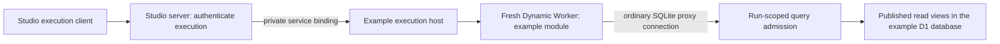

# Studio-hosted database preparation

Status: candidate preparation implementation, 2026-11-14. Follows the catalog in #707/#708
and market-backed examples in rune-cdm-example #5.

## Contract

An example uses ordinary Drizzle/SQLite query code. Its host supplies a database
connection: a normal adapter in a standalone application, or an execution-scoped
proxy when Studio runs it. The example must not depend on a Rune data-service
client. The CDM example owns its schema, driver and database; general Studio
projects continue to supply their own providers.

The initial implementation is an asynchronous data-preparation module, followed
by the existing synchronous Rune calculation/provider boundary. It does not
silently turn generated Rune functions into asynchronous functions. Prepared
records retain their snapshot/generation identities so callers can pin and replay
the calculation inputs. Existing portable snapshot imports remain supported.

## Trust boundary

Only the server host creates the connection and passes it into an isolated run.
The browser receives results, never D1 bindings, publisher credentials or a
reusable database token. There is no public SQL endpoint. The private execution
entrypoint is callable through the Studio server's service binding. The existing
public-fixing import contract does not admit SQL or private curve artifacts.

Studio authenticates its existing GitHub workspace bearer credential against
GitHub before forwarding a verified identity. The example host independently
requires an explicitly configured GitHub numeric-ID allowlist; absent configuration denies
execution. CORS, origin headers, repository names and client-supplied identity are
not authority. This establishes execution through the trusted Studio runtime;
it does not attest that a human used the graphical interface rather than an API.

The host creates a new Cloudflare Dynamic Worker for each run, with
`globalOutbound: null`, no inherited environment/bindings, a fixed compatibility
configuration and CPU/subrequest limits. The only resource passed to the run is
the restricted database connection. Submitted code never executes in the Pages
Function, loader host or an unrestricted `new Function` scope.

## Database admission

Drizzle's maintained SQLite proxy driver supplies the client query API. The
server parses SQL using a maintained SQLite parser, admits exactly one SELECT,
and rejects writes, administrative statements, joins, nested queries, CTE statements,
unapproved functions and references outside the admitted read views. Parameters
are bounded finite SQLite scalar values. Query admission is independent of the
client's claimed method and of TypeScript types.

Only `benchmark_data` and `sonia_ois_data` are exposed. These views join the
existing accepted publication records; staged/interrupted snapshots cannot leak.
They retain publication generation, source snapshot and source-unit text.
Historical rows remain explicit; a reader must select its intended vintage.
The canonical catalog remains responsible for imports, revision selection and
normalization; the proxy introduces no alternate ingestion or correction logic.

The host caps statements per run, result rows, response bytes, source/input size,
CPU and elapsed time. A connection is revoked when the run completes or expires;
concurrent calls consume the same run budget. Raw R2 archives, ingestion tables,
publisher methods and arbitrary URL fetches are never passed into the run.

## Preparation interface

A preparation module exports a default async function receiving a normal
SQLite-proxy connection and JSON inputs. It may import the example's bundled
driver/schema module. Outside Studio, the same query functions accept a normal
SQLite/D1-backed adapter. The preparation result is bounded JSON plus a receipt
identifying the project/input revision and execution. Credentials and raw runtime
exceptions are excluded from errors and telemetry.

The Studio client uses a generic hosted-preparation transport; database queries
stay in example code. Authentication and connection configuration are host state,
not generated source, project artifacts, calculated results or Git files.
Stale/canceled preparation results must not mutate the current workspace or
provider selection. Installation of prepared Rune overrides uses the existing
explicit Save/import path rather than a second persistence mechanism.

## Delivery and verification

- Add the two read views through Drizzle generation, with SQL and metadata.
- Implement SQL admission and a normal Drizzle driver against native SQLite and
  real D1, including all statement forms admitted by the proxy.
- Implement the isolated private execution entrypoint and Studio authentication
  gateway/client. Keep deployment and allowlist activation explicit.
- Exercise a real Worker Loader invocation against migrated Miniflare D1:
  ordinary query success, published/staged separation, SQL and method bypasses,
  denied imports/network, query/result limits and expiry/revocation.
- Verify authentication and payload limits fail before execution and that errors
  cannot reflect credentials or private runtime details.
- Demonstrate the same example driver against standalone SQLite and the hosted
  execution path. Preserve source attribution and snapshot/generation pins.

This change prepares a reviewable implementation; it does not deploy a public
Worker, activate daily publication or grant arbitrary projects the example data.

## Primary references

- [Drizzle SQLite proxy](https://orm.drizzle.team/docs/sqlite/connect-drizzle-proxy)
- [Cloudflare Dynamic Workers bindings](https://developers.cloudflare.com/dynamic-workers/usage/bindings/)
- [Network egress controls](https://developers.cloudflare.com/dynamic-workers/usage/egress-control/)
- [Authentication/authorization boundaries](https://developers.cloudflare.com/dynamic-workers/usage/authentication/)
- [SQLite parser](https://github.com/taozhi8833998/node-sql-parser)
